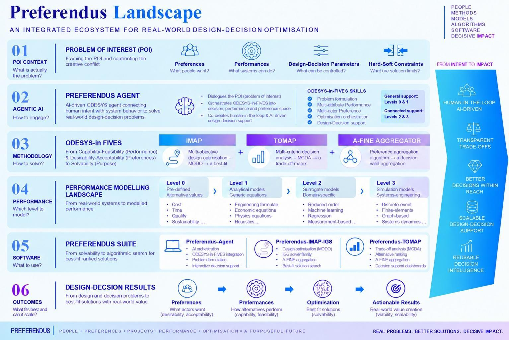
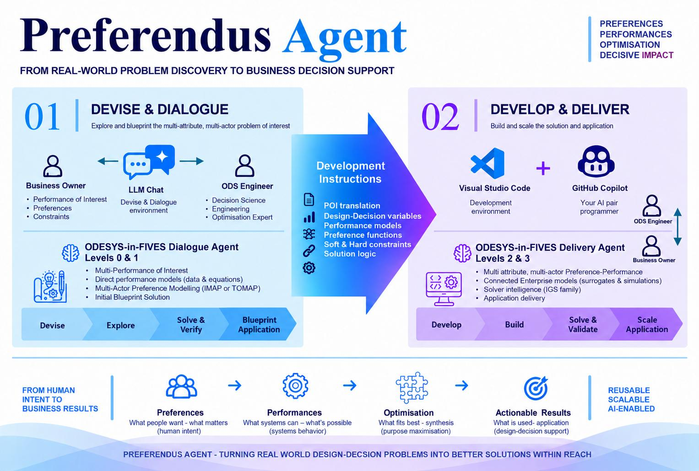
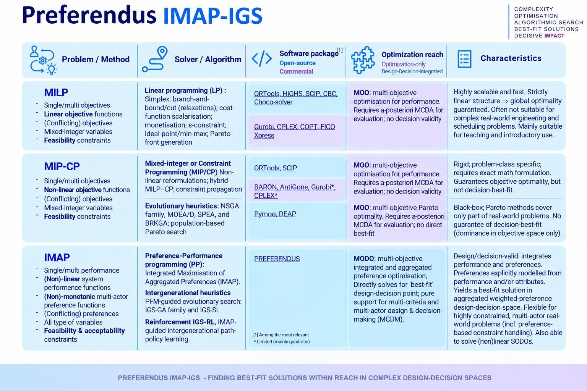

# Preferendus

*A unified ecosystem for real-world design-decision optimisation, supported by human-in-the-loop AI-driven ODESYS-in-FIVES orchestration for better solutions with decisive impact*

---

## About

ODESYS-in-FIVES is a state-of-the-art multidimensional design and decision systems methodology for multi-attribute, multi-actor design optimisation and decision analysis. It spans the design-decision problem-solving journey from intent to impact.

The methodology is operationalised through the Preferendus software suite, comprising:

- IMAP - Multi-objective design optimisation (MODO)
- TOMAP - Multi-criteria decision analysis (MCDA)
- A-FINE Aggregator - Decision-valid preference aggregation
- IGS Solver Family - Best-fit candidate search
- Preferendus-Agent - Agent AI-driven dialogue and delivery

For more information, see the [Preferendus Landscape](./261026_Preferendus_Landscape_Full.pdf) and accompanying documentation.

Earlier work, including the original open-source **Preferendus** and the IMAP-IGS solver family, can be found in the following GitHub repositories: [TUDelft-Odesys](https://github.com/TUDelft-Odesys) and [TUDelft-IMAP-IGS](https://github.com/TUDelft-IMAP-IGS), respectively.  For general information about ODESYS, readers are referred to [ODESYS](https://odesys.nl/).

---

## Preferendus Landscape - Agent - IMAP-IGS

 

---

## Repositories

### [`IMAP-IGS`]()
To be Published.

### [`TOMAP`]()
To be Published.

### [`A-FINE Aggregator`]()
To be Published.

### [`Preferendus-Agent`]()
To be Published.

---

## References

- Ozer, E. & Wolfert, A.R.M. (2026). Ordering Is Not Deciding: Towards Preference-Consistent Design–Decision Optimisation. To be published

- Timp, L.J.K., Yorke-Smith, N. & Wolfert, A.R.M (2026). Solving highly constrained multi-objective decision problems with preference-guided metaheuristics: The IMAP-
IGS framework. *ArXiv*. https://doi.org/10.48550/arXiv.2607.17304

- Wolfert, A.R.M. (2026). Preference-Based Optimisation in Group Decision-Making. *arXiv*. https://doi.org/10.48550/arXiv.2603.19050 

- Woflert, A.R.M. (2026). Unique Preference Aggregation in Design and Decision Making. *arXiv* https://doi.org/10.48550/arXiv.2601.19759

- Teuber, L.G., van Heukelum, H.J., & Wolfert, A.R.M. (2025). Advancing strategic planning and dynamic control of complex projects. *arXiv*. https://doi.org/10.48550/arXiv.2408.12422

- Teuber, L.G., & Wolfert, A.R.M. (2024). Confronting Conflicts to Yes: Untangling Wicked Problems with Open Design Systems. *arXiv*. https://doi.org/10.48550/arXiv.2409.10549

- Van Heukelum, H.J., Binnekamp, R., & Wolfert, A.R.M. (2024). Socio-technical systems integration and design: a multi-objective optimisation method based on integrative preference maximisation.  *arXiv*. https://doi.org/10.48550/arXiv.2304.07168

- Wolfert, A.R.M. (Rogier) (2023). *Open Design Systems*. IOS Press https://doi.org/10.3233/RIDS10 or https://books.open.tudelft.nl/home/catalog/book/78

---

## License

This project is licensed under the **MIT License** - see the [`LICENSE`](./LICENSE) file for details.

Creative Common (CC) 2026 Preferendus & Odesys Contributors
